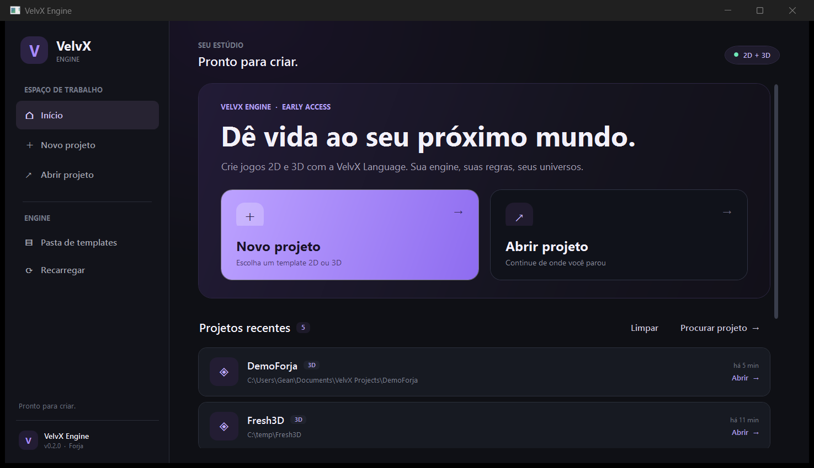
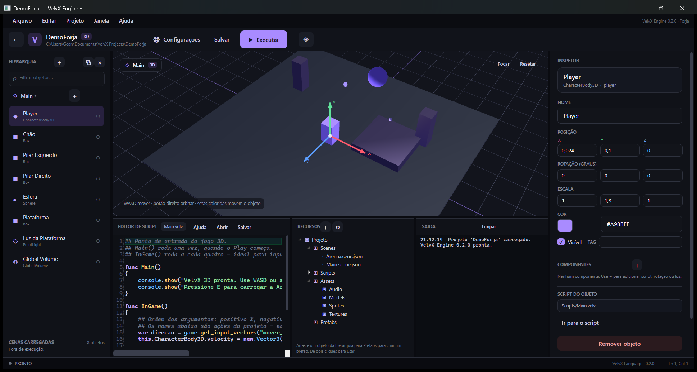
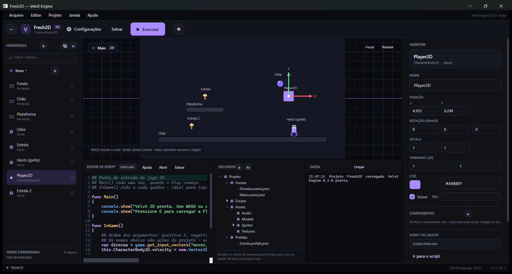
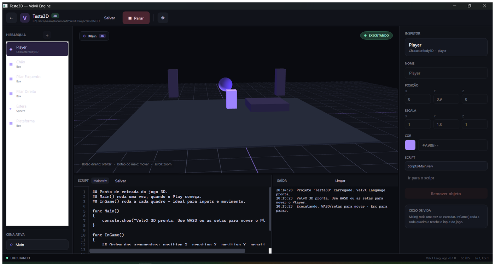
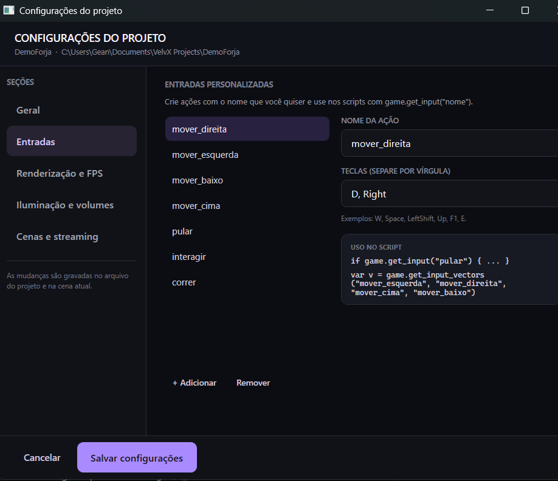

# VelvX Engine

**Sua engine, suas regras, seus universos.** Uma engine 2D e 3D para Windows, feita para criar jogos com a **VelvX Language** — do launcher ao modo Play.



> **Versão 0.3.0 — Bigorna.** A build que corrige os problemas da [issue #1](https://github.com/NoeXVel/VelvX-Engine/issues/1) e fecha a base para jogos de verdade: gizmos que seguem o objeto, seleção pelo viewport, **GameObject + Transform** com componentes obrigatórios, câmera nativa, janela grande de script com autocomplete, física simples com triggers, hierarquia e camadas, scripts globais, escala/textura por modelo e templates **Vazio 3D/Vazio 2D**. É a primeira build sem os defeitos estruturais da Forja.

## O que já funciona

### Editor

- **Launcher** com projetos recentes, catálogo de templates (Starter e Vazio) e abertura de projetos.
- **Novo projeto** 3D ou 2D com nome, pasta de destino e cópia do template. Os templates **Vazio 3D** e **Vazio 2D** começam apenas com a câmera e o script de entrada.
- **GameObject + Transform**: todo objeto tem transformação, nome, camada, pai e pode receber componentes. O tipo **Objeto vazio** serve de contêiner e marcador.
- **Hierarquia** com busca, seletor de cena, indicador de cenas carregadas e criação de objetos/cenas. O pai pode ser escolhido no inspetor, sem ciclos.
- **Inspetor** completo: nome, posição, rotação, escala, cor, visibilidade, tag, **camada**, **pai**, modelo (com **escala e textura**), sprite, luz, volume, câmera e **componentes**.
- **Setas de transformação (gizmos)** coloridas que **seguem o objeto** no viewport 3D e 2D: arraste X (vermelho), Y (verde) ou Z (azul). `Ctrl` arredonda para 0,25 e `Shift` para 0,1.
- **Seleção pelo viewport**: clique no objeto no 3D para selecioná-lo.
- **Câmera 3D de editor** com WASD/setas, `E`/`Q` para subir/descer, `Shift` para acelerar, botão direito para orbitar, botão do meio para mover e scroll para zoom.
- **Janela grande de script**: abra pelo botão **Ampliar** ou pelo menu **Editor de script**. Tem autocomplete (`Ctrl+Espaço`), auto-indent, realce da VelvX, lista dos scripts do projeto, referência rápida clicável, abrir/salvar/salvar como e status Ln/Col.
- **Painel de Recursos** ao lado da Saída: cenas, scripts e pastas `Assets/Audio`, `Assets/Models`, `Assets/Sprites`, `Assets/Textures` e `Prefabs`, com ícones por tipo e arrastar-soltar.
- **Prefabs**: arraste um objeto da hierarquia para `Prefabs` (ou use o menu de contexto) e arraste o prefab de volta para a cena.
- **Modo Play** com `F5`, `Esc` para parar, FPS ao vivo, restauração automática da cena e console de saída. A **câmera principal** do jogo é definida no inspetor.

### 3D

- Modelos **OBJ, FBX, GLTF e GLB** com texturas, importação pelo editor e pelo inspetor, com **escala** e **textura** ajustáveis por objeto.
- **Animações de modelo** (esqueleto ou nós) com escolha da animação, velocidade e loop.
- Iluminação com ambiente, sol direcional, **luzes pontuais** por objeto ou componente, **Global Volume** (tom global) e **Box Volume**.
- Componentes nativos: **Rotator**, **Mesh Renderer**, **PointLight**, **BoxCollider**, **SphereCollider**, **Rigidbody**, **AudioSource**, **Camera** e scripts.
- **Física simples** com AABBs, gravidade e **triggers** `OnTriggerEnter/Stay/Exit` nos scripts.

### 2D

- Sprites em PNG/JPG, **GIFs animados**, **spritesheets** com colunas, linhas, FPS e loop.
- Retângulos, elipses e personagens 2D com o mesmo sistema de cenas, componentes e scripts do 3D.
- Câmera 2D nativa e seleção/movimento com gizmos.

### Projeto e runtime

- **Configurações do Projeto** (`Ctrl+,`): nome, modo, **Inputs personalizados**, renderização/FPS, iluminação e volumes, cenas e streaming.
- **Camadas e scripts** (`Ctrl+,` → Camadas e scripts): camadas, matriz de colisão (pares `A|B` que não colidem) e lista de **scripts globais**.
- **Inputs próprios**: crie ações com qualquer nome e teclas separadas por vírgula; use `game.get_input("minha_acao")` e `game.get_input_vectors(...)`.
- **Múltiplas cenas**: carregue, descarregue e troque a cena ativa em tempo real com `Scene("Nome").load()`, `unload()`, `set_active()` e `is_loaded()`.
- **Hierarquia em scripts**: `get_parent()`, `get_children()`, `find_child("Nome")` e `is_child_of(outro)`.
- **Limite de FPS** configurável (padrão 60) e opção de esconder o contador.
- **VelvX Language** com variáveis, funções, `if`, `while`, vetores, strings interpoladas, acesso à cena, componentes e ciclo `Main()`/`InGame()`.
- **Build portátil** autossuficiente para `win-x64` (não exige .NET instalado).
- **Executor headless** para testar scripts sem abrir o editor.

| Editor 3D | Editor 2D |
| --- | --- |
|  |  |



## Requisitos

- Windows 10 ou 11, 64 bits.
- Para compilar: [.NET 8 SDK](https://dotnet.microsoft.com/download/dotnet/8.0) (o SDK 10 também compila o alvo `net8.0-windows`).
- Para usar a build portátil: nada além do Windows.

A Engine foi ajustada para computadores modestos (4–8 GB de RAM, GTX 1650): o viewport usa WPF 3D com limite de FPS, iluminação simples e carregamento de cenas sob demanda. Os templates já vêm com o limite em 60 FPS.

## Executar pelo código

```powershell
cd "C:\Users\Gean\Documents\MyEngine"
dotnet run
```

Ou abra `VelvX.Engine.csproj` no Visual Studio 2022 com a carga de trabalho **.NET desktop development**.

Na primeira execução, o launcher mostra os templates do repositório. Crie um projeto em **Novo projeto**, escolha **3D**, **2D**, **Vazio 3D** ou **Vazio 2D** e o editor abre em seguida.

## Gerar a build portátil

```powershell
powershell -ExecutionPolicy Bypass -File .\build.ps1
```

O script publica em `dist\VelvX-Engine-win-x64`, confere o executável e gera `dist\VelvX-Engine-win-x64.zip`. Extraia o zip em qualquer pasta e execute `VelvX.Engine.exe`.

A pasta `dist/` fica fora do Git; publique o zip em **Releases** no GitHub — veja [docs/GITHUB.md](docs/GITHUB.md).

## Primeiros passos

1. **Novo projeto** → escolha **Projeto 3D**, **Projeto 2D**, **Vazio 3D** ou **Vazio 2D** → dê um nome → **Criar projeto**. Os templates Vazio começam apenas com a câmera e o script de entrada.
2. No editor, selecione um objeto e mova-o com as **setas coloridas** ou edite os campos do inspetor.
3. Navegue pela cena 3D com **WASD** (e **E/Q** para subir/descer) ou orbite com o botão direito.
4. Edite `Scripts/Main.velv` no painel de script e clique em **Salvar**.
5. Pressione **F5** e mova o Player com **WASD** ou as **setas**. No template 3D, pressione **E** para carregar a **Arena** por streaming; no 2D, a **Floresta**.
6. Pressione **Esc** para parar. A cena volta ao estado salvo.

### Controles do editor

| Ação | Controle |
| --- | --- |
| Iniciar / parar o jogo | `F5` / `Esc` |
| Salvar projeto | `Ctrl+S` |
| Configurações do Projeto | `Ctrl+,` |
| Focar o objeto selecionado | `F` ou botão **Focar** |
| Mover a câmera 3D | `WASD` / setas |
| Subir / descer a câmera 3D | `E` / `Q` |
| Acelerar a câmera | `Shift` |
| Orbitar / mover a câmera | botão direito / botão do meio + arrastar |
| Zoom | scroll do mouse |
| Resetar a câmera | botão **Resetar** |
| Selecionar objeto | clique no viewport ou na hierarquia |
| Mover objeto | arrastar as setas X/Y/Z |
| Duplicar / remover | `Ctrl+D` / `Delete` |
| Mover o jogador no Play | `WASD` ou setas |
| Janela grande de script | botão **Ampliar** ou menu **Editor de script** |
| Autocomplete no script | `Ctrl+Espaço` |

## Inputs personalizados

Abra **Configurações do Projeto** (`Ctrl+,`) → **Entradas** → **Adicionar**. Dê um nome à ação e informe as teclas separadas por vírgula, por exemplo `Space`, `LeftShift`, `F1` ou `Q`.



No script, use o nome da ação:

```velv
func InGame()
{
    var direcao = game.get_input_vectors("mover_direita", "mover_esquerda", "mover_cima", "mover_baixo");
    this.CharacterBody3D.velocity = new.Vector3(direcao.x * 6, 0, direcao.y * 6);

    if game.get_input("atacar")
    {
        console.show("Ataque!");
    }
}
```

Os nomes padrão (`mover_direita`, `mover_esquerda`, `mover_cima`, `mover_baixo`, `pular`, `interagir`, `correr`) continuam funcionando mesmo que você crie os seus.

## Streaming de cenas

Uma cena pode carregar outra sem sair do jogo. A cena ativa continua sendo atualizada; use `set_active()` para trocar a que recebe o jogador e os scripts.

```velv
func Main()
{
    Scene("Arena").load();
}

func InGame()
{
    if game.get_input("interagir") and not Scene("Arena").is_loaded()
    {
        Scene("Arena").load();
        console.show("Arena carregada por streaming.");
    }
}
```

Crie novas cenas pelo botão **+** ao lado do seletor de cena na hierarquia, ou adicione um arquivo `.scene.json` em `Scenes/`.

## Componentes

Todo objeto é um **GameObject** com **Transform** e pode receber componentes. No inspetor, use **+** em **Componentes** para adicionar:

- **Script**: escolha um arquivo `.velv`; o código roda a cada quadro com `this` apontando para o objeto.
- **Câmera**: FOV, near, far e opção de câmera principal do Play.
- **Mesh Renderer**: malha (caixa, esfera ou modelo), cor, escala e textura.
- **Box Collider / Sphere Collider**: camada de colisão e modo trigger.
- **Rigidbody**: massa, gravidade e uso da gravidade.
- **Audio Source**: arquivo de áudio, volume e loop.
- **Rotator**: gira o objeto em torno de um eixo com velocidade configurável.
- **Animador de sprite**: animação de spritesheet.
- **PointLight**: luz pontual com cor, intensidade e alcance.
- **Box Volume**: área de efeito.

```velv
func InGame()
{
    this.rotation.y = this.rotation.y + game.delta_time * 45;
}
```

### Triggers e hierarquia

Colliders com **trigger** disparam callbacks no script do objeto:

```velv
func OnTriggerEnter(outro)
{
    console.show("Entrou em contato com " + outro.name);
}

func OnTriggerExit(outro)
{
    console.show("Saiu de " + outro.name);
}

func InGame()
{
    var pai = this.get_parent();
    var filhos = this.get_children();
    var alvo = this.find_child("Porta");
}
```

As camadas e os pares que não colidem ficam em **Configurações do Projeto → Camadas e scripts**. A mesma página lista os **scripts globais**, executados a cada quadro antes dos scripts dos objetos.

### Câmeras

Objetos `Camera3D`/`Camera2D` (ou o componente **Câmera**) têm FOV, near, far e a opção **Câmera principal no modo Play**. Só uma câmera é principal por vez; no menu de contexto use **Definir como câmera do jogo**.

## Assets e prefabs

- **Modelos 3D**: menu **Projeto → Importar modelo 3D…** ou arraste um `.obj`, `.fbx`, `.gltf` ou `.glb` para `Assets/Models`. Selecione o objeto `Model3D` e escolha o modelo, a animação, a velocidade e o loop no inspetor.
- **Sprites**: importe PNG/JPG/GIF em `Assets/Sprites` e use um objeto `Sprite`. Para spritesheets, informe colunas, linhas, FPS e loop.
- **Prefabs**: arraste um objeto da hierarquia para a pasta `Prefabs` para criar o prefab; arraste o prefab de volta para a cena para instanciar. Também há **Criar prefab do selecionado** no menu de contexto.

## Iluminação, volumes e desempenho

Cada cena 3D tem um ambiente com luz ambiente, sol direcional, fundo em gradiente e neblina. Objetos `PointLight` iluminam ao redor, `GlobalVolume` aplica um tom global e `BoxVolume` delimita uma área de efeito. Tudo isso é editável no inspetor e em **Configurações do Projeto → Iluminação e volumes**.

Para desempenho:

- mantenha o **limite de FPS** em 60 (ou 30 em máquinas mais modestas);
- carregue cenas grandes sob demanda com streaming;
- prefira luzes pontuais com alcance curto;
- evite modelos com milhões de triângulos;
- use `ShowFps` para acompanhar o contador no rodapé.

## VelvX Language em 30 segundos

```velv
# Script de entrada: roda uma vez ao iniciar.
func Main()
{
    console.show("Bem-vindo ao meu mundo!");
}

# Roda a cada quadro.
func InGame()
{
    var direcao = game.get_input_vectors("mover_direita", "mover_esquerda", "mover_cima", "mover_baixo");
    this.CharacterBody3D.velocity = new.Vector3(direcao.x * 6, 0, direcao.y * 6);

    var orbe = Scene("Main").object.Esfera;
    orbe.rotation.y += game.delta_time * 40;
}
```

Comentários `#`, `//`, `/* */` e `#* *#`; variáveis `var vida : Int = 100;` ou `var vida := 100;`; funções; `if`/`else`; `while`; vetores `Vector2`/`Vector3`; `console.show/warn/error`; `this`; `Scene("...")`; `Assets.pathObject("...")`.

A referência completa está em [docs/VelvX-Language.md](docs/VelvX-Language.md).

## Estrutura do projeto

```
VelvX.Engine.csproj
App.xaml / MainWindow.xaml      launcher
Windows/EditorWindow.xaml       editor de cenas
Windows/ProjectSettingsWindow   configurações do projeto
Core/                           projetos, cenas, templates, caminhos
Language/                       lexer, parser, AST, interpretador, realce
Runtime/                        sessão de jogo, input, cenas, headless
Rendering/                      viewports 3D/2D, modelos, animações
Theme/                          tema escuro e barra de título
Templates/                      modelos 2D/3D e README de templates
docs/                           linguagem, arquitetura, GitHub e capturas
tests/                          scripts de teste e automação de UI
```

Um projeto criado pela Engine tem esta cara:

```
MeuJogo/
├─ MeuJogo.velvxproj
├─ Scenes/
│  ├─ Main.scene.json
│  └─ Arena.scene.json
├─ Scripts/
│  ├─ Main.velv
│  └─ ComponenteExemplo.velv
├─ Prefabs/
├─ Assets/
│  ├─ Audio/
│  ├─ Models/
│  ├─ Sprites/
│  └─ Textures/
```

## Templates personalizados

Monte um projeto do zero, copie a pasta dele para `Templates/<nome>` e adicione um `template.json`:

```json
{
  "id": "meu-template",
  "name": "Meu template",
  "description": "Minha base de jogo personalizada.",
  "mode": "3D",
  "version": "0.3.0"
}
```

O template aparece em **Novo projeto** depois de **Recarregar**. Detalhes em [Templates/README.md](Templates/README.md).

## Executor headless

```powershell
.\bin\Release\net8.0-windows\VelvX.Engine.exe --run-script tests\language-smoke.velv --frames 10
```

Opções: `--frames N`, `--scene arquivo.scene.json`, `--mode 2D|3D`, `--out resultado.txt` e `--open "pasta do projeto"`. O código de retorno é `0` em sucesso e `1` em erro. O executor encontra o `.velvxproj` automaticamente e usa os Inputs personalizados do projeto.

## Documentação

- [VelvX Language](docs/VelvX-Language.md) — sintaxe, tipos, operadores, APIs e limites.
- [Arquitetura](docs/ARQUITETURA.md) — como o launcher, o editor, o runtime e o build se conectam.
- [Publicando no GitHub](docs/GITHUB.md) — primeiro envio, atualizações e releases.
- [Notas da versão 0.3.0](docs/RELEASE-v0.3.0.md) — correções da issue #1, novidades e limitações da build Bigorna.
- [Notas da versão 0.2.0](docs/RELEASE-v0.2.0.md) — histórico da build Forja.

## Roteiro

Sistema de UI, matriz de colisão visual, hierarquia aninhada, jogo de exemplo, exportação de jogo independente, física mais completa, áudio, animação com blending, tilemaps, compilador VelvX para bytecode e builds incrementais. O objetivo é uma ferramenta própria, profissional, para jogos comerciais 2D e 3D.

---

Feito por **Gean** · VelvX Engine 0.3.0 “Bigorna” · [github.com/NoeXVel/VelvX-Engine](https://github.com/NoeXVel/VelvX-Engine)
