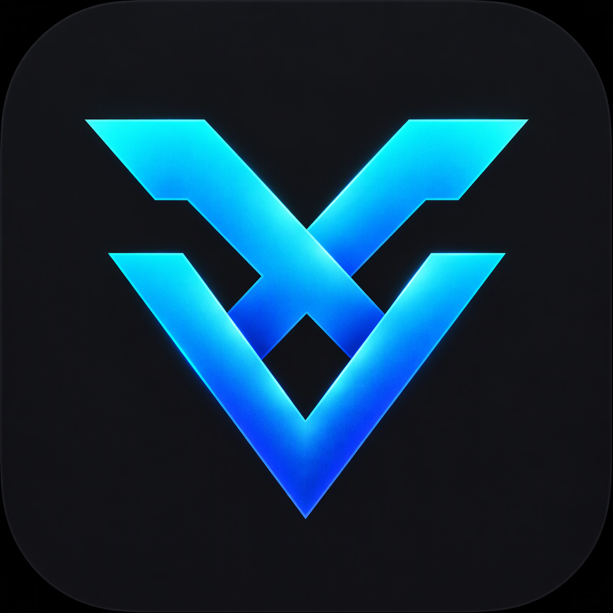

<p align="center">
  
</p>

<h1 align="center">VelvX Engine</h1>

<p align="center">
  <strong>Engine de jogos 2D/3D em C++20</strong> — editor visual completo,
  linguagem de script própria (<strong>Velv Language</strong>), plugins nativos
  e exportação de jogos standalone.
</p>

<p align="center">
  Renderização OpenGL 3.3 core (GLAD + GLFW) · UI de ferramentas em ImGui (docking) ·
  Importação de modelos via Assimp (FBX/glTF/OBJ) · Windows 10/11 x64
</p>

---

## Visão geral

A VelvX foi construída para **fazer jogos de verdade**: do protótipo ao produto
publicável, com um fluxo de trabalho no estilo das grandes engines — hierarquia
de objetos, Inspector com campos editáveis em runtime, Asset Browser com
thumbnails, gizmos de transformação, undo/redo, Play/Stop e exportação com um
clique. O núcleo é uma DLL nativa em C++20; as ferramentas são aplicações ImGui
com tema grafite e docking.

**Destaques**

- **Editor completo** — Hierarchy, Inspector, Asset Browser (thumbnails +
  drag&drop), Console, viewports **Scene** e **Game**, menus de contexto,
  undo/redo por snapshots JSON, Project Settings e exportação de jogo.
- **Velv Language** — linguagem própria, interpretada, com `book` (funções com
  parâmetros e `return`), `lock`/`unlock` (variáveis privadas / expostas no
  Inspector com ligação bidirecional em runtime), `if/else`, `while`, `break`,
  recursão e mais de 90 funções nativas de engine.
- **Física integrada** — RigidBody/StaticBody/Collider AABB, gravidade por
  objeto, matriz de colisão por camada, raycast, triggers e ground detection.
- **Renderizador** — pipeline 2D/3D no mesmo framebuffer, sombras direcionais,
  MSAA, projeção ortho/perspectiva, importador Assimp.
- **UI de jogo** — prefabs `.ui` (JSON) com âncoras, botões com script binding,
  editor visual dedicado e preview em tempo real.
- **Plugins nativos** — DLLs com API `IPlugin` + `ComponentRegistry`;
  componentes de plugin aparecem no Inspector e serializam nas cenas.
- **Exportação standalone** — executável + DLLs + shaders + plugins, assets
  opcionalmente compactados em `assets.zip` (miniz), `Jogar.bat` gerado.
- **66 testes automatizados** headless do interpretador e do núcleo.

## Ferramentas

Tudo é compilado e entregue em **`Build Release/`**.

| Executável | Função |
|---|---|
| `VelvXEditor.exe` | Editor completo: Hierarchy, Inspector (campos `UNLOCKED` editáveis), Asset Browser com thumbnails e drag&drop, Console, viewports **Scene** (gizmos Move/Rotate/Scale) e **Game** (câmera ativa), menus de contexto, undo/redo, Play/Stop, Project Settings, exportação. |
| `VelvXLauncher.exe` | Lista/cria/abre projetos; inicia o Editor ou a Play Window. |
| `VelvXScriptIDE.exe` | IDE da Velv Language: abas multi-arquivo, autocomplete contextual (`Ctrl+Espaço`) com assinaturas, dicas de parâmetros, auto-indent, auto-close, busca/substituição, marcadores de erro. |
| `VelvXUIEditor.exe` | Editor visual de UI: drag&drop de botões/textos/imagens/painéis, posição relativa/absoluta, script binding, preview em tempo real, prefabs `.ui`. |
| `VelvXPlayer.exe` | Play Window: executa o projeto sem o editor, usando as Project Settings. |
| `VelvXTests.exe` | Bateria headless de testes do interpretador e do núcleo. |
| `VelvXEngine.exe` | Demo técnica da fase 1 (cenas de exemplo + script). |

DLLs compartilhadas: `VelvXEngineCore.dll` (núcleo), `glfw3.dll`, `glad.dll`.
Plugin de exemplo: `plugins/CustomPhysics.dll`.

## Começando

### Opção 1 — Portable (recomendado para testar)

Baixe `VelvXEngine-<versão>-portable.zip` em
[Releases](../../releases), extraia e execute `VelvXLauncher.exe`.
Não instala nada, não escreve no registro.

### Opção 2 — Instalador

Baixe `VelvXEngine-<versão>-setup.exe` em [Releases](../../releases) e
execute. O assistente gráfico instala por usuário (sem admin) em
`%LOCALAPPDATA%\VelvXEngine` (pasta configurável), cria atalhos no Menu
Iniciar e na Área de Trabalho, associa arquivos `.velv`/`.ui` e registra o
desinstalador em Adicionar/Remover Programas. Modo silencioso:
`VelvXEngine-<versão>-setup.exe /S /D=<pasta>`.

### Opção 3 — Compilar do código

Requisitos: Windows + Visual Studio 2022/2026 (MSVC), CMake ≥ 3.20, Ninja.
Todas as dependências estão vendorizadas em `Source/third_party/`
(GLFW, GLAD, GLM, stb, miniz, Assimp, ImGui docking).

```bat
Source\build_release.bat
```

ou manualmente:

```bat
cmake -S Source -B Source/build -G Ninja -DCMAKE_BUILD_TYPE=Release
cmake --build Source/build
```

O CMake raiz (`CMakeLists.txt`) apenas encaminha para `Source/`. Saída: exes,
DLLs, `shaders/`, `scenes/`, `scripts/`, `Demos/`, `templates/` e `plugins/`
em `Build Release/`. Linux/macOS: mesmo comando CMake com GCC/Clang
(experimental; as ferramentas usam GLFW/OpenGL 3.3).

### Primeiro projeto

1. `VelvXLauncher.exe` → **Criar projeto** (templates: `EmptyProject`,
   `2DPlatformerTemplate`, `3DFPSTemplate`) → **Abrir no Editor**.
2. Edite a cena no viewport (botão direito orbita, meio pan, roda zoom),
   selecione objetos na Hierarchy, edite Transform/components e campos
   `UNLOCKED` no Inspector, arraste assets do Asset Browser para a cena.
   **Botão direito na Hierarchy** cria objetos (vazio, cubo, plano, sprite,
   luz, câmera…) e adiciona componentes/scripts.
3. **Play** inicia o `VelvXPlayer.exe` com o projeto salvo; **Stop** encerra.
4. **Ferramentas → Exportar jogo** gera o jogo standalone.
5. Duplo clique em `.velv` abre o Script IDE; em `.ui` abre o UI Editor.

Guia completo: **[Docs/GettingStarted.md](Docs/GettingStarted.md)**.

## Demos incluídos

Dois jogos completos — com menu, HUD, pausa e tela de fim — escritos
inteiramente em Velv Language, prontos para abrir, jogar e estudar.

### CRYSTAL RUSH (`Demos/Game1_2D`) — plataforma 2D

Três fases com dificuldade crescente (horizontal, gaps e patrulhas, escalada
vertical), moedas coletáveis, hazards com respawn, HUD de score/moedas/tempo,
menu inicial, pausa e tela de vitória/derrota. Câmera ortho segue o jogador.

```bat
VelvXPlayer.exe --project "Demos/Game1_2D/Game1_2D.velvproj"
```

### ARENA NEON (`Demos/Game2_3D`) — FPS de ondas

Arena 3D com iluminação neon: movimento WASD + mouse-look, tiro por raycast,
recarga, ondas de inimigos que perseguem o jogador (clonados via
`Instantiate(GameObject.find(...))`), HUD de vida/munição/onda/score, pausa e
tela de fim com estatísticas.

```bat
VelvXPlayer.exe --project "Demos/Game2_3D/Game2_3D.velvproj"
```

Ambos também abrem pelo Launcher. Os scripts comentados em
`Demos/*/scripts/*.velv` são o melhor material de estudo da linguagem.

## Velv Language (`.velv`)

```velv
unlock speed = 6;        // editável no Inspector do Editor
lock score = 0;          // privada (fora do Inspector)

book add(a, b)           // books aceitam parâmetros e return
{
    return a + b;
}

book Main()              // executado uma vez
{
    SceneManager.loadScene("Level1");
    UI.loadPrefab("ui/HUD.ui");
}

book InGame()            // executado a cada frame
{
    if (Input.isKeyPressed(Key.Space)) {
        lock cube = Instantiate("Cube", vec3(0, 8, 0));
        score = add(score, 1);
        UI.setText("Score", "Cubos: " + str(score));
    }
}
```

- **`lock` / `unlock`** — `lock` é privada; `unlock` aparece no Inspector e é
  editável em runtime com ligação bidirecional (editar no Inspector reflete no
  script e vice-versa). **`let` não existe.**
- **`book`** — funções nomeadas com parâmetros, `return` e recursão; `Main`
  roda uma vez e `InGame` a cada frame; books também são chamáveis entre si.
- **Controle de fluxo** — `if/else`, `while`, `break`, `return`.
- **`self`** — o GameObject dono do script (em scripts anexados a objetos).
- **Nativos** — `SceneManager`, `Camera`, `GameObject`, `Input`, `Key`,
  `Trigger`, `Inspector`, `Assets`, `UI`, `Physics`, `Time`, `Application`;
  globais `print`, `vec3`, `str`, `rand`, `Instantiate`, `Destroy`, `sin`,
  `cos`, `sqrt`, `abs`, `floor`, `min`, `max`, `clamp`, `dt`, `time`.
- `Instantiate` aceita protótipo (`"Cube"`) **ou um GameObject da cena**
  (clona, preservando tag/scripts — base do spawning de inimigos).

Referência completa da linguagem (sintaxe, todos os nativos, padrões de jogo,
depuração): **[Docs/VelvLanguage.md](Docs/VelvLanguage.md)**.

## Editor — atalhos e contexto

| Atalho | Ação |
|---|---|
| `W` / `E` / `R` | Gizmo Mover / Rotacionar / Escala (viewport Scene) |
| `F` | Focar a câmera no objeto selecionado |
| `Delete` | Excluir objeto selecionado |
| `Ctrl+D` | Duplicar selecionado |
| `Ctrl+C` / `Ctrl+V` | Copiar / Colar objeto |
| `Ctrl+N` | Criar objeto vazio |
| `Ctrl+Z` / `Ctrl+Y` (ou `Ctrl+Shift+Z`) | Desfazer / Refazer |
| `Ctrl+S` / `Ctrl+Shift+S` | Salvar projeto+cena / Salvar cena como |
| `Ctrl+O` | Abrir projeto |

Botão direito na **Hierarchy**: criar (vazio, cubo, plano, sprite, luz,
câmera…), Renomear, Duplicar, Excluir, Focar, Copiar, Colar, Adicionar
componente (RigidBody/StaticBody/Collider/Camera/MeshRenderer), Anexar script.
Botão direito no **Asset Browser**: Abrir, Renomear, Duplicar, Excluir (com
confirmação), Copiar caminho, Revelar no Explorer. Undo/redo usa snapshots
JSON da cena. **Janela → Restaurar layout padrão** reconstrói o docking.

## Arquitetura

```
Source/
├── EngineCore/          Núcleo em DLL (VelvXEngineCore.dll)
│   ├── Core/            GameObject, Scene, SceneManager, Transform, Inspector,
│   │                    Project, ProjectSettings, AssetBrowser
│   ├── Renderer/        Viewport duplo 2D/3D, sombras, MSAA, ortho, Assimp
│   ├── Physics/         RigidBody, StaticBody, Collider, CollisionSystem
│   ├── Scripting/       Interpretador Velv
│   ├── Input/           Teclado/mouse/gamepad (perfis Xbox/PlayStation)
│   ├── UI/              UIManager + prefabs .ui
│   ├── PluginAPI/       IPlugin + ComponentRegistry
│   └── Utils/           Json, FileSystem, ThreadPool, PackFile/miniz
├── Editor/ Launcher/ ScriptIDE/ UIEditor/   Ferramentas ImGui
├── Plugins/CustomPhysics/                   Plugin de exemplo
├── Demos/ templates/                        Copiados para Build Release/
└── shaders/                                 GLSL 330 core
```

- **Plugins**: DLLs em `plugins/` exportando `velvxPluginCreate()` (API
  `IPlugin` em `EngineCore/include/PluginAPI/`). O exemplo registra
  `CustomPhysicsComponent` no `ComponentRegistry` — adicionável pelo Inspector
  e serializável nas cenas (`.vscene`, chave `components`).
- **Project Settings**: janela (resolução/fullscreen/título), input (perfis,
  bindings, deadzone), gráficos (MSAA 0/2/4/8, sombra 512–4096, vsync), áudio,
  interface. Persistidas no `.velvproj` e aplicadas pelo Player.
- **Exportação**: `Editor → Ferramentas → Exportar jogo` — pack ZIP opcional
  lido pelo Player via `--pack`, PDBs opcionais, `Jogar.bat` gerado. O jogo
  exportado roda sem o editor e sem a árvore de fontes.

Detalhes internos (pipeline de frame, interpretador, física, build):
**[Docs/Architecture.md](Docs/Architecture.md)**.

## Testes

Bateria headless (sem janela/GL) do interpretador e do núcleo — **66 testes**:

```bat
cd "Build Release"
VelvXTests.exe
```

Cobre: `lock`/`unlock` e ligação bidirecional com o Inspector; books com
parâmetros/`return`/`break`/recursão; `if/else`/`while`/`vec3`/booleanos;
estados isolados por instância; física (colisão AABB, ground detection,
gravidade por objeto, matriz de colisão por camada, empilhamento, apoio em
corpo kinematic, contenção contra parede, convenção do Collider local);
serialização de cena (round-trip preservando objetos, componentes, scripts,
hierarquia e câmera — backbone do undo/redo); seleção de câmera ativa e clone.

Logs em `velvx.log` (raiz do projeto/executável). O Console do Editor espelha
o log em tempo real.

## Empacotamento e Releases

Os artefatos de distribuição são gerados a partir de `Build Release/`:

```bat
packaging\make_portable.bat     → dist\VelvXEngine-<versão>-portable.zip
packaging\make_installer.bat    → dist\VelvXEngine-<versão>-setup.exe
```

- **Portable**: zip com as ferramentas, DLLs, shaders, demos, templates e
  plugins — sem PDBs/logs/arquivos de sessão. Extraia e use.
- **Instalador**: `VelvXSetup.exe` nativo (wizard Win32, arquivo único com
  payload embutido) — instala por usuário em `%LOCALAPPDATA%\VelvXEngine`,
  cria atalhos, associa `.velv`/`.ui` e inclui desinstalador integrado.

Cada Release no GitHub deve conter os dois artefatos + as notas de versão.
Veja [Docs/GettingStarted.md](Docs/GettingStarted.md) para o fluxo completo.

## Documentação

| Documento | Conteúdo |
|---|---|
| [Docs/GettingStarted.md](Docs/GettingStarted.md) | Instalação, tour do editor, atalhos, estrutura de projeto, física, UI, publicação. |
| [Docs/VelvLanguage.md](Docs/VelvLanguage.md) | Referência completa da Velv Language: sintaxe, nativos, padrões de jogo, depuração. |
| [Docs/Architecture.md](Docs/Architecture.md) | Arquitetura interna: pipeline de frame, interpretador, física, renderizador, build e testes. |

## Licença

[MIT](LICENSE) — use, modifique e distribua, inclusive comercialmente.